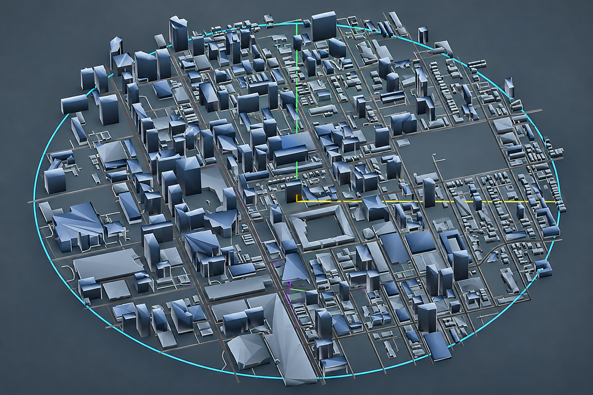
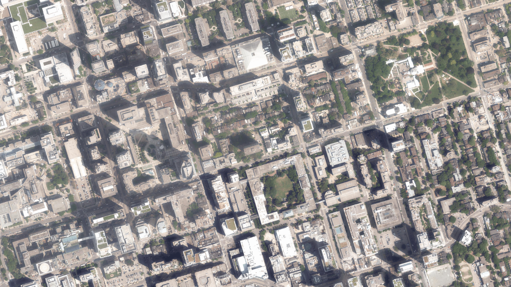
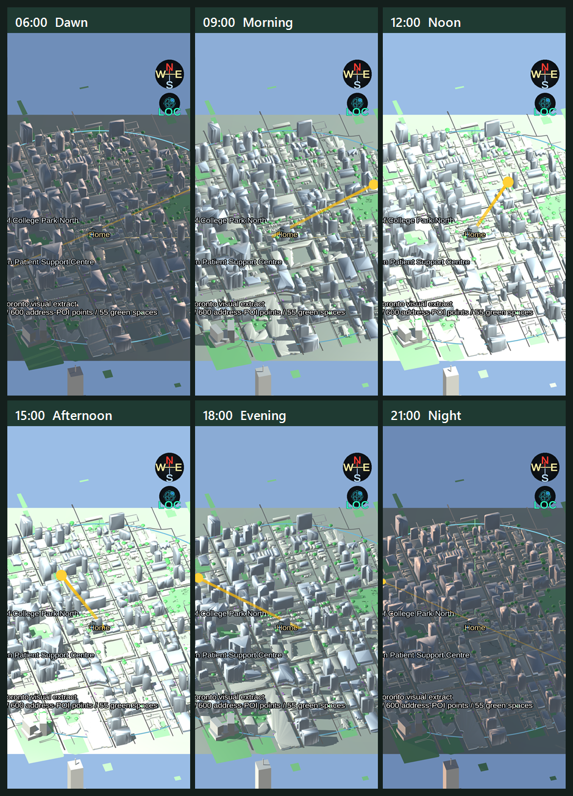
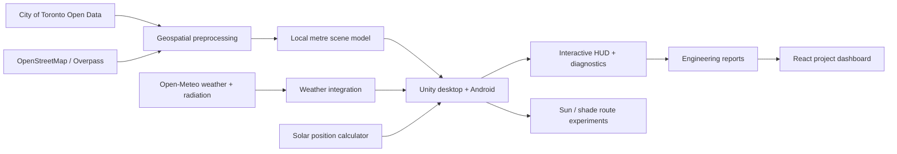
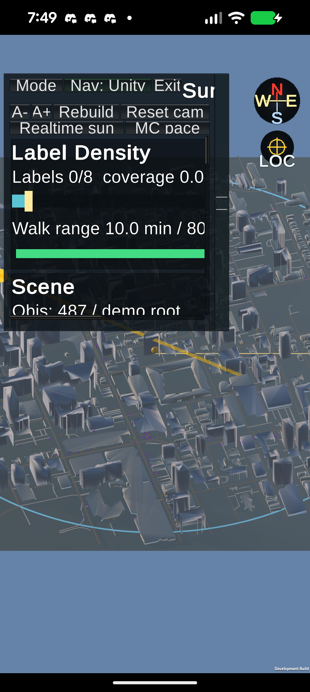
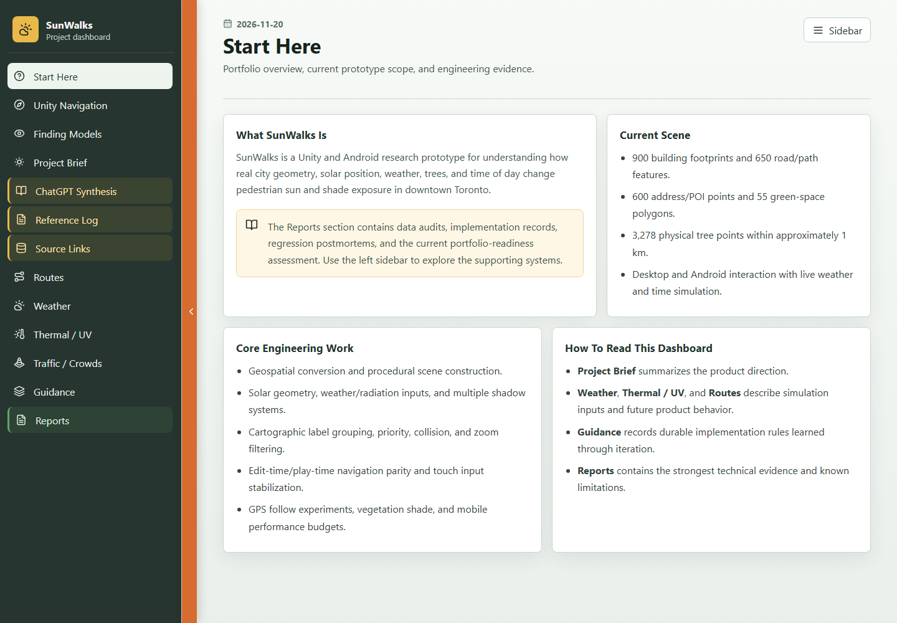

  

# SunWalks

**A weather-aware urban sunlight and shade simulator for pedestrian-scale Toronto.**

SunWalks explores a practical question that conventional maps do not answer: **what will a walk feel like in the sun, shade, wind, and heat at a particular time?** The prototype combines real city geometry, solar position, live weather and radiation data, building and tree shade, map-label decluttering, and mobile location tracking in an interactive Unity scene.

[Explore the engineering dashboard](https://nastajus.github.io/SunWalks/) · [View the source data](#data-and-attribution) · [See the roadmap](#next-goals)

> This repository is a curated portfolio overview. The complete Unity project and its development history are not currently published here.

## Why this project exists

Route planners optimize distance and travel time. SunWalks is investigating a different layer of pedestrian navigation: how buildings, trees, weather, season, and time of day change solar exposure and perceived comfort along a route.

The long-term goal is a route system that can answer questions such as:

- Which nearby path has the most shade during a heat event?
- Where will winter sunlight reach the sidewalk at a given time?
- How does cloud cover or twilight change the useful difference between sun-seeking and shade-seeking routes?
- Can a mobile experience follow a pedestrian while preserving enough spatial and lighting fidelity to make those decisions useful?

## Current prototype

The current home-area scene is generated around a real downtown Toronto origin and runs on desktop and Android.

| Scene layer | Current prototype scale |
| --- | ---: |
| Building footprints | 900 |
| Road and path features | 650 |
| Address / POI points | 600 |
| Green-space polygons | 55 |
| Physical tree points | 3,278 |
| Primary geographic envelope | 800 m radius |
| Tree / green-space context | approximately 1 km radius |

These counts describe the current imported preview, not a claim of complete real-world coverage.

## City-scale shadow geometry

The generated city is compared with official Toronto aerial imagery to evaluate building alignment, projected-shadow direction, and the much harder problem of tree and canopy coverage. The sharp shadows in the reference make the core objective tangible: SunWalks is not only drawing a map, but trying to model where direct sunlight is physically blocked at pedestrian scale.

## Major features

### Geospatial scene generation

- Converts latitude and longitude into a local Unity metre coordinate system.
- Extrudes OpenStreetMap building footprints into selectable 3D massing.
- Builds roads, paths, address points, green spaces, landmark context, and a simplified waterfront as separate inspectable layers.
- Preserves city-grid orientation rather than assuming that Toronto aligns with world north.
- Supports a dynamic one-to-ten-minute walk-range filter for visible scene content.

### Sun, weather, and shadows

- Calculates solar azimuth and elevation from date, time, latitude, and longitude.
- Drives a directional sun light and exposes a looping 24-hour simulation control.
- Synchronizes current Toronto weather and radiation fields through Open-Meteo.
- Models clear, broken-cloud, overcast, fog, precipitation, heat-haze, twilight, and seasonal lighting states.
- Adjusts sky, ambient, direct-light, and surface hues across dawn, daylight, twilight, and night; the clock can run in real time, at an accelerated pace, or at a manually selected hour.
- Separates native Unity cast shadows, lighting profiles, projected diagnostics, and approximate tree dapple shade so each system can be tested independently.

The following Android captures use the same scene and camera while the 24-hour simulation is scrubbed through six representative times. They document the current visual color progression rather than claiming photometric calibration.

### Map readability

- Uses screen-space label budgets, priority, zoom thresholds, collision rejection, and adjustable coverage limits.
- Groups road segments into named streets instead of labelling every imported segment.
- Aligns street labels to their paths and limits repeated names along the same road.
- Supports compact and outlined label styles, occlusion behind buildings, hover / touch label probing, and object selection labels.

### Desktop and mobile interaction

- Provides Unity-style and Blender-style camera navigation.
- Bridges Game View pan, orbit, and wheel zoom into Unity edit mode as well as play mode.
- Includes a resizable, collapsible, searchable HUD with desktop and touch interaction.
- Supports Android auto-rotation, touch smoothing, mobile label budgets, simplified rendering while moving, and ARM64 IL2CPP builds.
- Includes experimental GPS tracking, auto-follow, an accuracy marker, and a reference grid that can align to true north or Toronto's street grid.

### Engineering observability

- Exposes sun angle, radiation, weather gating, label coverage, shadow state, caster / receiver counts, tree budgets, walk range, and camera state in the runtime HUD.
- Maintains a React engineering dashboard with implementation reports, regression postmortems, data audits, source links, and durable project guidance.
- Includes repeatable VS Code launch, Unity build, Android deployment, and dashboard workflows.

### Predictive shade-aware routing

The route prototype already samples direct-sun exposure along candidate graph edges and changes their cost for shade-seeking, sun-seeking, or balanced preferences. The planned next layer is a forward-looking comfort heuristic: score the path ahead, estimate upcoming sunny and shaded stretches, and recommend whether to remain in shade, cross toward a better-covered segment, or use a sunny "oasis" before a long shadowed stretch. This turns the simulation from a passive map into a walking decision aid while keeping the recommendation explainable.

## System architecture

The Unity application is deliberately layered: source geometry, local coordinate conversion, scene generation, lighting/weather, labels, navigation, and diagnostics can be inspected separately. This separation has been important because visual brightness, native cast shadows, projected overlays, and route exposure are related but technically different systems.

## Selected engineering challenges

### Edit-time and play-time input parity

Unity's Game View normally treats the mouse wheel as an editor display-scale control while the application is stopped. SunWalks includes an editor bridge that routes wheel, Alt + left-drag orbit, and middle-drag pan to the simulation without leaving a global mouse hook active while Unity is unfocused. This required explicit handling for Windows display scaling, Game View coordinates, HUD hit testing, event ownership, and editor lifecycle cleanup.

### Stable cartographic labels in a 3D scene

Naively rendering every imported name produced thousands of overlapping labels and repeated street names. The current system ranks candidates, groups continuous streets, aligns text to road paths, enforces repeat distance, rejects screen-space collisions, and recalculates within controlled distance buckets. The result is intentionally conservative: scene geometry remains primary and labels appear only when space and importance justify them.

### Lighting calibration versus shadow correctness

Matching perceived outdoor brightness is not the same problem as enabling projected shadows. SunWalks therefore treats solar position, weather/radiation gating, ambient and direct illumination, native shadow-map state, and visual comparison profiles as separate diagnostics. The dashboard records failed approaches as well as the settings that made regressions reproducible.

### Mobile performance under dense city data

The Android build uses reduced label and tree budgets, throttled lighting / label refreshes, input smoothing, and optional simplification while the camera is moving. The current approach is suitable for prototyping; city-scale deployment will require tiled streaming, LODs, and stronger profiling.

### Tree coverage is the limiting dataset

Tree accuracy is currently the largest data risk. Toronto's physical-tree layer provides useful aerial/LiDAR-derived point locations and height attributes, but points can be missed near tall buildings or deep shadow and they do not describe crown shape. The generalized Green Spaces layer is also not an exhaustive parcel-level inventory of private lawns. Private and institutional canopy is visible in aerial imagery, so the project cannot safely treat either dataset as complete or assume that all private trees are absent. The intended reconciliation combines physical-tree points, Forest and Land Cover or canopy polygons, aerial imagery, crown estimation, and duplicate suppression with an explicit spatial tolerance. Coverage must be measured against imagery before route-level shade claims become trustworthy.

## Visual development

### Android lighting and label-density controls

| Android prototype | What this view demonstrates |
| --- | --- |
|  | The touch HUD exposes simulated time, lighting and shadow profiles, weather state, label budgets, and scene diagnostics directly on the phone. Its collapsible modes preserve map space while keeping the same core controls available on desktop and Android. |

### Engineering and regression dashboard

The dashboard preserves implementation reports, failed approaches, regression timelines, source audits, screenshots, and durable engineering guidance. It is intentionally shown at full width because the report index and evidence columns become difficult to inspect when compressed beside a portrait capture.

## Data and attribution

SunWalks currently integrates or evaluates the following sources:

- [OpenStreetMap](https://www.openstreetmap.org/) and [Overpass API](https://wiki.openstreetmap.org/wiki/Overpass_API) for building footprints, roads, paths, addresses, and POI context. OpenStreetMap data is available under the [ODbL](https://www.openstreetmap.org/copyright).
- [City of Toronto Open Data: physical tree locations](https://open.toronto.ca/dataset/topographic-mapping-physical-location-of-trees/) for individual tree points and source height attributes.
- [City of Toronto Open Data: Green Spaces](https://open.toronto.ca/dataset/green-spaces/) for generalized park and open-space polygons.
- [City of Toronto 3D Massing](https://open.toronto.ca/dataset/3d-massing/), Toronto Centreline, Pedestrian Network, Sidewalk Inventory, Address Points, and Forest and Land Cover as current or planned authoritative layers.
- [Open-Meteo](https://open-meteo.com/) for current weather, cloud cover, wind, precipitation, and solar-radiation fields.

The current Unity preview uses OSM-derived building massing. City datasets are evaluated independently and are not presented as legal, surveying, accessibility, or safety-grade data.

## Technology

- Unity 6.1 / C# / IMGUI
- Android ARM64 / IL2CPP
- React / TypeScript / Vite
- OpenStreetMap Overpass QL
- City of Toronto Open Data
- Open-Meteo forecast API
- Blender preprocessing experiments
- PowerShell, Node.js, ADB, VS Code tooling

## Prototype boundaries

- Building footprints and road geometry are useful visual approximations, not survey-grade models.
- Tree crowns and fragmented canopy shadows are inferred from point data and adjustable heuristics.
- Current tree coverage is incomplete and has not yet been quantitatively reconciled against aerial canopy across the full scene.
- Weather-aware lighting is visually calibrated but is not a physically based atmospheric simulation.
- Shade-aware route scoring exists as a prototype graph cost, but the home-area scene is not yet a complete pedestrian-network router.
- The HUD prioritizes diagnostics over final consumer-product visual design.

## Next goals

1. Replace preview building massing with clipped, validated City of Toronto 3D Massing tiles and explicit LODs.
2. Build a true pedestrian-network reachability and route pipeline with forward-looking sun/shade scoring rather than using a circular walk envelope.
3. Reconcile tree points with canopy / land-cover data and aerial imagery, then quantify false positives, missed canopy, crown uncertainty, and duplicate sources.
4. Add reproducible solar, coordinate, route-cost, and scene-import tests.
5. Capture a concise portfolio demo showing time-of-day change, weather modes, label decluttering, GPS follow, and Android interaction.
6. Profile and stream geographic tiles so the simulation can expand beyond the current local scene.

## Project status

SunWalks is an active research prototype and portfolio project. It demonstrates end-to-end geospatial ingestion, interactive simulation, cross-platform Unity engineering, and an unusually detailed record of iterative debugging. It is not currently offered as a navigation or health-safety product.
